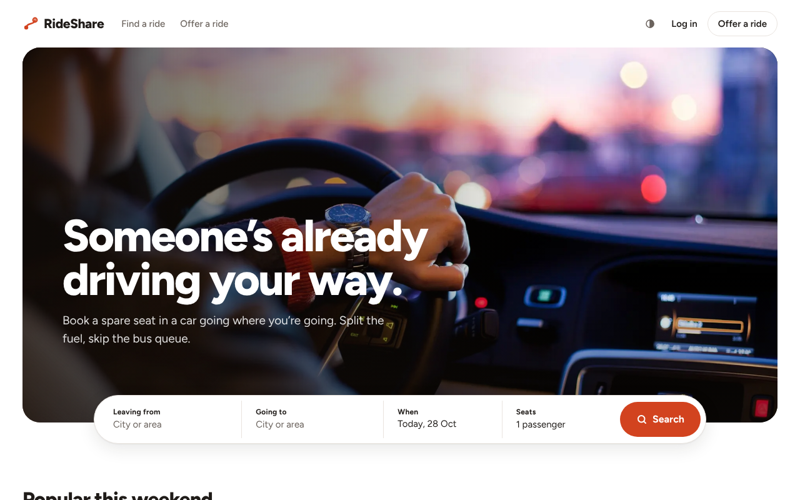
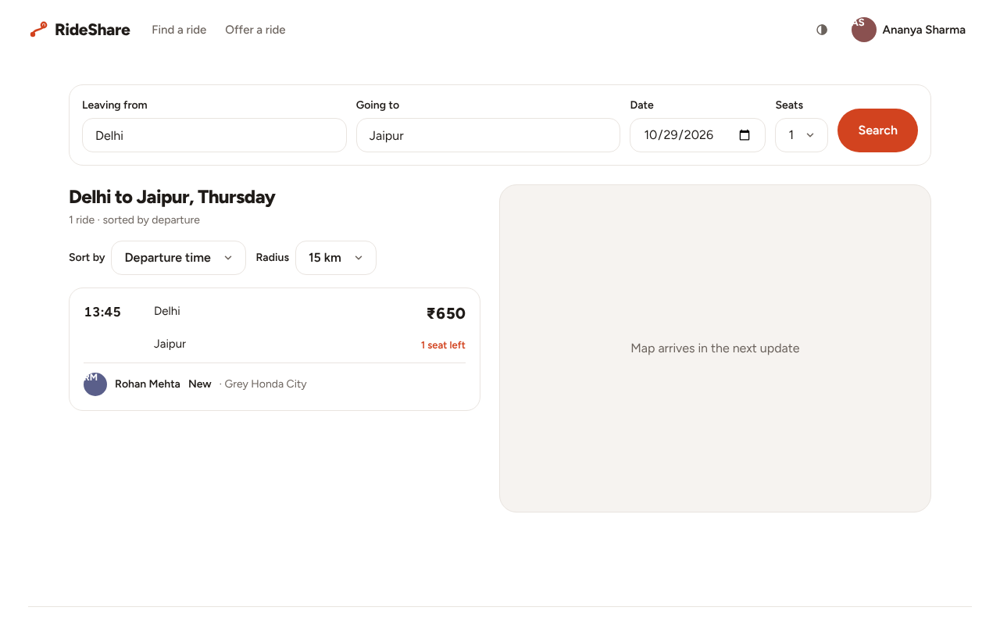
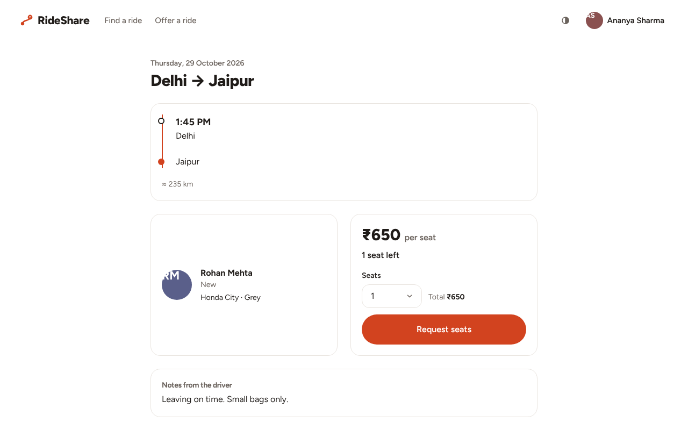
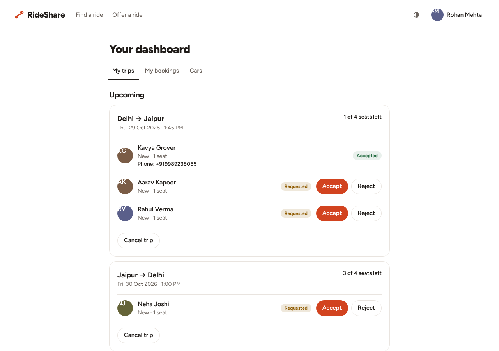
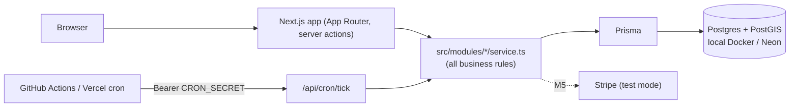

# RideShare

RideShare is a BlaBlaCar-style carpool web app for intercity trips in northern India. Drivers publish a trip with seats and a price; passengers search by route and date, request seats, and the driver accepts or rejects. Phone numbers are shared only once a booking is accepted. Built with Next.js, Prisma and Postgres/PostGIS. This is milestone M1 (core booking loop); payments, maps, messaging and reviews follow in later milestones.

| Home (desktop, light) | Home (mobile, dark) |
| --- | --- |
|  |  |

| Search results | Trip page |
| --- | --- |
|  |  |



## M1 features

- Email + password sign-up and login (optional Google sign-in), with a demo-accounts panel on `/login`
- Cars: add and remove vehicles (1-7 passenger seats)
- Publish a trip: origin and destination from ten cities and pickup areas, date and time in IST, seats, price per seat
- Search by route and date with radius (5-50 km), sort and pagination; photographic home page with popular routes
- Request 1-4 seats; seats are held atomically so a trip can never be oversold
- Driver dashboard to accept or reject requests; passenger dashboard to track and cancel bookings
- Cancellation rules with a refund preview (full refund more than 24 h before departure); driver cancel refunds everyone
- Cron tick: expire stale requests, complete finished trips
- Phone numbers revealed only while a booking is accepted or completed
- Light and dark themes, reduced-motion support, mobile layout

## Architecture



Pages and actions never touch Prisma directly; rules live in module services, and `bookings.transition()` is the only code that changes a booking's status.

## Booking lifecycle

```mermaid
stateDiagram-v2
  [*] --> PENDING_PAYMENT: request (M5 only; M1 starts at REQUESTED)
  PENDING_PAYMENT --> REQUESTED: card authorized
  PENDING_PAYMENT --> ABANDONED: 15 min, no card
  [*] --> REQUESTED: request (M1)
  REQUESTED --> ACCEPTED: driver accepts
  REQUESTED --> REJECTED: driver rejects
  REQUESTED --> EXPIRED: expiresAt passes
  REQUESTED --> CANCELLED: passenger cancels
  ACCEPTED --> CANCELLED: passenger cancels (full refund > 24 h before, none after) or driver/admin cancels (full refund)
  ACCEPTED --> COMPLETED: trip completed (cron)
  ABANDONED --> [*]
  REJECTED --> [*]
  EXPIRED --> [*]
  CANCELLED --> [*]
  COMPLETED --> [*]
```



`expiresAt = min(requestedAt + 24 h, departureAt)`. Every move into ABANDONED, REJECTED, EXPIRED or CANCELLED returns the seats in the same transaction.

## Local setup

Requires Node 22 and Docker.

```bash
docker compose up -d           # Postgres + PostGIS
cp .env.example .env           # then set AUTH_SECRET (e.g. `openssl rand -base64 32`) and CRON_SECRET
npm install
npm run db:migrate
npm run db:seed                # ~30 users, ~80 trips, bookings in every state
npm run dev                    # http://localhost:3000
```

Log in with a demo account from the panel on `/login`: `driver@demo.test`, `passenger@demo.test` or `admin@demo.test`, password `demo-ride-2026`. `npm run db:seed` wipes the database before inserting, so re-running it is safe; it refuses to run with `NODE_ENV=production` unless `SEED_ALLOW=1`.

## Tests

```bash
npm run lint && npm run typecheck
npm test                       # unit + component tests (Vitest)
npm run test:int               # integration tests against DATABASE_URL_TEST (needs the Docker DB)
npm run test:e2e               # Playwright against `npm run dev`
E2E_SEED=1 npm run test:e2e    # also reseeds the dev DB first and runs the demo-login spec
```

Playwright uses the browsers in `PLAYWRIGHT_BROWSERS_PATH`; on a fresh machine run `npx playwright install chromium` once. To regenerate the README screenshots: `npm run db:seed`, start `npm run dev`, then `npx tsx scripts/screenshots.ts`.

## Payments

There are no payments in M1: requests hold seats and drivers accept or reject. Stripe (test mode) card authorization and capture arrive in M5; the payment hooks in `src/modules/payments/service.ts` are no-ops until then.

## Deploy

Vercel + Neon, with a GitHub Actions cron: see [docs/deploy.md](docs/deploy.md).

## Credits

Photographs are from Unsplash; every photo and its photographer is listed on the in-app [credits page](src/app/credits/page.tsx) (`/credits`).
